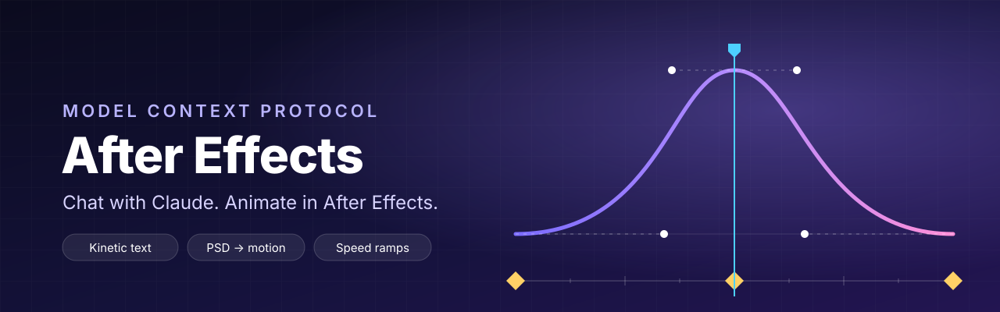
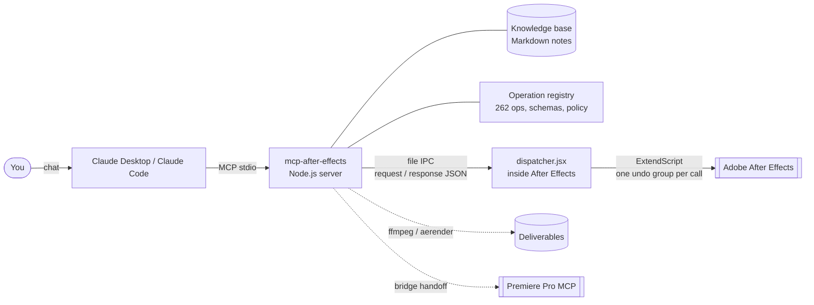

<p align="center">
  
</p>

<h1 align="center">mcp-after-effects</h1>

<p align="center">
  <a href="LICENSE"></a>
  
  
  
  
</p>

<p align="center">
  <b>Tell Claude what you want to see. It builds it in After Effects.</b>
</p>

**mcp-after-effects** is a [Model Context Protocol](https://modelcontextprotocol.io) server that connects Claude (Desktop or Code) to a running Adobe After Effects. Instead of a thin wrapper around ExtendScript, it ships the motion designer's toolbox as ready-made operations: eased keyframe presets, per-letter kinetic text, a PSD-to-animation pipeline, scene transitions, speed ramps, a Premiere Pro round trip, delivery presets, post-delivery clean-up and a knowledge base Claude reads before it plans. Every edit is one undo step, and nothing leaves your machine except what your MCP client sends to the model.

---

## Contents

- [Features](#features)
- [How it works](#how-it-works)
- [Quick start](#quick-start)
- [Using it from chat](#using-it-from-chat)
- [Main operations](#main-operations)
- [Safety](#safety)
- [Configuration](#configuration)
- [Multiple After Effects instances](#multiple-after-effects-instances)
- [Troubleshooting](#troubleshooting)
- [Roadmap](#roadmap)
- [Development](#development)
- [License](#license)

## Features

| Area                           | What you get                                                                                                                                                                                                                                                                                                                           |
| ------------------------------ | -------------------------------------------------------------------------------------------------------------------------------------------------------------------------------------------------------------------------------------------------------------------------------------------------------------------------------------- |
| **Keyframe master**            | Write a whole keyframe list with easing in one call (`keyframe.apply`), set bezier influence and speed, shift, copy, rove. `anim.review` finds robotic motion (linear keys, no motion blur, no stagger) and `anim.polish` fixes it in place. `anim.adjust` retimes existing animation from feedback like "slower in" or "0.2 s later". |
| **Motion presets**             | 30+ entrances and exits that keep the layer's final values (fade, rise, slide, pop, whip, flip, swing, zoom blur…), expression loops on top (float, sway, pulse, hop, flutter, twinkle) with sliders you can tune by hand, and templates for lower thirds, title cards and logo reveals.                                               |
| **Kinetic text**               | Per-character, per-word or per-line text animators: typewriter, char pop, rise, drop, blur, wave, scale wave, jitter, tracking in. `anim.shine` sweeps light across text or across titles that are images.                                                                                                                             |
| **PSD → animation**            | `psd.import` brings a layered PSD in as a ready-to-animate comp; `psd.plan` gives every layer a role (background, logo, headline, info, CTA, hero, decor) from its name or geometry; `psd.auto_animate` applies the plan as one undo step; `psd.animate_scenes` builds a whole multi-scene reel with a different look per scene.       |
| **Scene transitions**          | `anim.scene_transition`: push, slide up, whip pan with motion blur, 3D card flip, dream dissolve, zoom blur, timed on the cut.                                                                                                                                                                                                         |
| **Speed ramp**                 | `anim.speed_ramp` with Time Remap: slow-mo on the hit, fast-slow, slow-fast, ramp in-out, stutter, or your own segments, always eased.                                                                                                                                                                                                 |
| **Premiere bridge**            | `bridge.from_premiere` rebuilds a clip sent from a Premiere MCP as a frame-accurate comp with handles; `bridge.to_premiere` renders it back as ProRes 4444 with alpha.                                                                                                                                                                 |
| **Export presets**             | `render.export` renders one ProRes master, then makes YouTube 4K/1080, Reels/TikTok 9:16, Feed 4:5, square, LED wall, watermarked review and PNG-alpha deliverables with ffmpeg, loudness-normalised and versioned (`V1`, `V2`…). Background renders through `aerender` keep After Effects usable.                                     |
| **Project clean-up**           | `project.review_unused` reports footage and files no delivered comp uses (recursively, proxies included); `project.clean_unused` removes them after you confirm, with a checkpoint first and Finder's Trash instead of permanent deletion.                                                                                             |
| **Brand kits**                 | Colours, fonts and logo per client (`brand.save`, `brand.apply`), a logo library finder that judges transparency and tone from the pixels, and colour extraction from finished artwork.                                                                                                                                                |
| **Knowledge base**             | `ae_guide` serves Markdown notes on workflow rules, easing and timing, kinetic typography, glow, grading, ExtendScript pitfalls, render order, export specs and the plug-ins, presets and MOGRTs actually installed on the machine. Add a note by dropping a file in the folder; nothing to rebuild.                                   |
| **Full After Effects surface** | 262 operations across 31 categories: comps, layers, shapes, masks, effects, expressions, text, fonts, markers, footage, render queue, Essential Graphics, preferences, instances.                                                                                                                                                      |

## How it works



Claude sees a small set of tools (`ae_context`, `ae_catalog`, `ae_do`, `ae_render_frame`, `ae_guide`…). `ae_catalog` lists the operations and their parameters, `ae_do` runs one, and `ae_render_frame` lets Claude look at the result before it reports back. Arguments are validated against a schema in Node and reach ExtendScript only as serialised values, never as concatenated code.

## Quick start

### Requirements

- macOS (the code paths for Windows exist, but day-to-day use and testing happen on macOS)
- Adobe After Effects 2026 (2024 and 2025 should work)
- Node.js 20 or newer
- Claude Desktop or Claude Code
- Optional: `ffmpeg` on your `PATH` for `render.export`

### 1. Install and build

```bash
git clone https://github.com/Miinwan/mcp-after-effects.git
cd mcp-after-effects
npm install
npm run build
```

### 2. Prepare After Effects

- **Settings → Scripting & Expressions → Allow Scripts to Write Files and Access Network**: on.
- macOS will ask whether your MCP client may control After Effects the first time; allow it (System Settings → Privacy & Security → Automation). Accessibility permission is optional and makes dialog detection exact.

### 3. Register the server

**Claude Desktop**: add this to `~/Library/Application Support/Claude/claude_desktop_config.json`, then restart Claude.

```json
{
  "mcpServers": {
    "after-effects": {
      "command": "node",
      "args": ["/path/to/mcp-after-effects/dist/index.js"],
      "env": {
        "MCP_LOGO_DIR": "/path/to/Client Logos"
      }
    }
  }
}
```

**Claude Code**:

```bash
claude mcp add after-effects -- node /path/to/mcp-after-effects/dist/index.js
```

Open a project in After Effects, start a chat, and ask Claude to describe the active comp. If it answers with the layer list, you are connected.

## Using it from chat

You describe the result; Claude reads the relevant knowledge note, inspects the project, plans, applies and renders a frame to check its own work. Some prompts that work well:

> Import `~/Desktop/poster.psd` at 30 fps, 10 seconds, and animate it: the logo stays still, the headline pops in letter by letter, everything else rises in with a stagger.

> The title comes in too fast. Make the entrance 0.3 s slower and softer, and add a light sweep after it lands.

> Put a whip transition between Scene 1 and Scene 2, and a speed ramp with slow motion on the jump in the drone shot.

> Review the animation in "Main" like a senior motion designer and fix the mechanical problems.

> Export "Main" for YouTube 1080 and Reels, client "Acme", title "Launch teaser".

> The job is delivered. Show me what footage and files are unused, then clean up after I confirm.

## Main operations

Run `ae_catalog` for the full list with parameters. The ones you will meet most:

| Category     | Operations                                                                                                                                          |
| ------------ | --------------------------------------------------------------------------------------------------------------------------------------------------- |
| `anim`       | `anim.apply`, `anim.loop`, `anim.apply_plan`, `anim.adjust`, `anim.review`, `anim.polish`, `anim.speed_ramp`, `anim.scene_transition`, `anim.shine` |
| `text`       | `text.animate`, `text.set_content`, `text.set_style`, `text.measure`, `text.qa`                                                                     |
| `psd`        | `psd.import`, `psd.plan`, `psd.auto_animate`, `psd.sequence_scenes`, `psd.animate_scenes`                                                           |
| `template`   | `template.lower_third`, `template.title_card`, `template.logo_reveal`, `template.transition`                                                        |
| `keyframe`   | `keyframe.apply`, `keyframe.add`, `keyframe.set_easing`, `keyframe.set_batch`, `keyframe.shift`, `keyframe.copy`, `keyframe.set_spatial`            |
| `expression` | `expression.set`, `expression.apply_preset`, `expression.validate`, `expression.disable_all`, `expression.restore_all`                              |
| `render`     | `render.export`, `render.export_status`, `render.background`, `render.frame_diff`, `render.variants`, `render.add_to_queue`                         |
| `bridge`     | `bridge.from_premiere`, `bridge.to_premiere`                                                                                                        |
| `project`    | `project.checkpoint`, `project.review_unused`, `project.clean_unused`, `project.merge`, `project.open`, `project.import_file`                       |
| `brand`      | `brand.save`, `brand.apply`, `brand.find_logo`, `brand.scan_logos`, `brand.colors_from_file`                                                        |
| `data`       | `data.to_comps` (one comp per data row from a template)                                                                                             |
| `instance`   | `instance.list`, `instance.start`, `instance.stop`, `instance.dialogs`, `instance.dismiss_dialog`                                                   |

Top-level tools are listed in [docs/TOOLS.md](docs/TOOLS.md).

## Safety

- **One undo group per call.** Every `ae_do` call is a single step in After Effects' history, so one Cmd+Z reverts whatever Claude just did. Batches (`anim.apply_plan`, `psd.auto_animate`) are one step too.
- **Checkpoints.** `project.checkpoint` saves and copies the `.aep` into a timestamped folder before big edits; destructive operations such as `project.clean_unused` take one automatically.
- **Dialog detection.** A modal dialog freezes ExtendScript. The server detects it, quotes its text in a `DIALOG_OPEN` error instead of hanging, and `instance.dismiss_dialog` cancels it safely (nothing is saved or discarded).
- **Read-only mode.** Set `AE_MCP_READONLY=1` to inspect, audit and render frames without any write operation being available.
- **Scoped permissions.** `AE_MCP_ALLOW_CATEGORIES` limits Claude to the categories you list (for example only `keyframe,text`).
- **No arbitrary code by default.** Free-form ExtendScript (`eval.run`) is disabled unless you set `AE_MCP_ENABLE_EVAL=1`. Enabling it gives the model the same reach as any script on your machine.
- **Nothing is deleted permanently.** File clean-up goes through Finder's Trash and only touches files inside the job folder.

> [!CAUTION]
> Project contents Claude reads (comp and layer names, expressions, file paths) are sent to the model provider by your MCP client. For projects under NDA, check your provider's data policy first, and try new workflows on a copy of the `.aep`.

## Configuration

| Variable                  | Purpose                                                                       |
| ------------------------- | ----------------------------------------------------------------------------- |
| `AE_MCP_READONLY`         | `1` disables every write operation.                                           |
| `AE_MCP_ALLOW_CATEGORIES` | Comma-separated categories Claude may use.                                    |
| `AE_MCP_ENABLE_EVAL`      | `1` enables arbitrary ExtendScript (`eval.run`).                              |
| `AE_MCP_EXE`              | Path to the After Effects executable when it is not in the standard location. |
| `AE_MCP_INSTANCE`         | Default After Effects instance to address (see below).                        |
| `AE_MCP_KNOWLEDGE_DIR`    | Use another folder as the knowledge base.                                     |
| `AE_MCP_BRAND_DIR`        | Where brand kits are stored.                                                  |
| `MCP_LOGO_DIR`            | Client logo library (one folder per client).                                  |
| `AE_MCP_AERENDER`         | Path to `aerender` for background renders.                                    |

Machine-specific values can also live in `config.local.json` at the repo root (git-ignored). Copy [`config.local.example.json`](config.local.example.json) and set, for example, `logoDir`. Environment variables take precedence.

## Multiple After Effects instances

After Effects can run several copies at once (`-m`). Instances started that way only receive scripts through a small resident agent, installed once per After Effects version:

```bash
node dist/index.js install-agent
```

Then every tool takes an optional `instance` argument, `AE_MCP_INSTANCE` sets the default, and `instance.list` shows what is live. `instance.start { name, copyFrom }` launches a worker on a copy of the project; `project.merge` brings its work back into the main project. `node dist/index.js agent-status` tells you when the agent needs reinstalling.

## Troubleshooting

| Symptom                         | Fix                                                                                                                                                                                                                                            |
| ------------------------------- | ---------------------------------------------------------------------------------------------------------------------------------------------------------------------------------------------------------------------------------------------- |
| Calls time out                  | After Effects running, a project open, "Allow Scripts to Write Files and Access Network" on, Automation permission granted.                                                                                                                    |
| `DIALOG_OPEN`                   | After Effects is showing a modal (often "files are missing", hidden behind the main window). Read the quoted text, then close it or call `instance.dismiss_dialog`. Opening projects with `project.open` suppresses the missing-files warning. |
| `NO_INSTANCE`                   | Instances started with `-m` need the agent, or several are live and none is named. The error lists the live ones.                                                                                                                              |
| Safe Mode "We detected a crash" | An After Effects process was killed. Dismiss the dialog on screen; prefer `instance.stop` over killing.                                                                                                                                        |
| `render.export` fails           | Install `ffmpeg` and make sure it is on the `PATH` of the app that runs the server.                                                                                                                                                            |

## Roadmap

- [x] Motion presets, kinetic text, PSD pipeline, scene transitions, speed ramp
- [x] Premiere Pro round trip, delivery presets, post-delivery clean-up
- [x] Knowledge base with installed plug-ins, presets and MOGRTs
- [ ] Beat detection from music to time cuts and accents
- [ ] Richer 3D (Advanced 3D renderer, camera moves from a brief)
- [ ] Shape-layer icon and lottie-style loops library
- [ ] Windows test pass

## Development

```bash
npm run build          # compile TypeScript to dist/
npm test               # unit tests (e2e suites skip themselves without After Effects)
npm run check          # typecheck, lint, format, JSX ES3 lint, server.json, tool docs
npm run quet-plugin    # rescan installed plug-ins into the knowledge base
```

Architecture, the operation contract and how to add an operation are in [CONTRIBUTING.md](CONTRIBUTING.md). Release notes are in [CHANGELOG.md](CHANGELOG.md).

## License

[MIT](LICENSE) © 2026 Miinwan.

Adobe® and After Effects® are trademarks of Adobe Inc. This is an independent project, not affiliated with or endorsed by Adobe.
